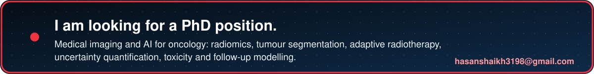
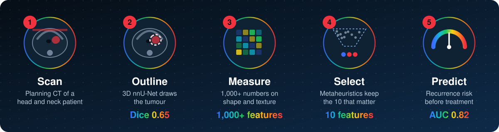
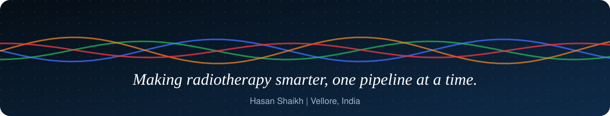

I teach machines to read cancer scans, and then I check whether they are telling the truth.

I am a data scientist in the **Quantitative Imaging Research and AI Lab ([QIRAIL](https://qirail.cmcvellore.edu.in/))**, Department of Radiation Oncology, **Christian Medical College, Vellore**, one of India's leading cancer centres. My work asks one question over and over: **before we treat, can we tell who is likely to relapse?**

I built a radiomics signature that predicts head and neck cancer recurrence (AUC 0.82), a segmentation model that outlines tumours from CT alone, and the data pipelines behind a 2,000+ patient imaging study. Then I reproduced a published AI model with the authors' own code and showed that its headline numbers did not hold up. Building models and breaking them: both are the job.

A planning CT goes in. A 3D nnU-Net outlines the tumour. PyRadiomics turns the outline into more than 1,000 numbers about shape, brightness and texture. Metaheuristic search keeps the few that are stable and useful. A model then estimates recurrence risk *before treatment*, with SHAP showing a clinician why.

- **Radiomics-based outcome prediction** for head and neck cancer
- **Automated tumour segmentation** with 3D CNNs and nnU-Net
- **Adaptive radiotherapy** and treatment-planning automation
- **Uncertainty quantification** in clinical AI
- **Reproducibility and trustworthy AI**: CLAIM and TRIPOD+AI assessments
- **Multimodal deep learning** across imaging, clinical and genomic data
- **DICOM/PACS engineering** and clinical data pipelines (Orthanc, XNAT, AWS S3)

| # | Work | Status |
|---|---|---|
| 1 | Anatomy-guided skip-connection recalibration for CT-based head and neck tumor auto-segmentation. *International Journal of Biomedical Imaging* | Under submission |
| 2 | Can reproducibility be achieved? External validation of "reproducible" image-based prognostic models for head and neck cancer. *Scientific Reports* | Under submission |
| 3 | Development and validation of a prospective radiomics-clinical signature for locoregional recurrence in locally advanced head and neck cancer. *ESTRO 2026, Stockholm* | **Poster highlight** ([abstract](https://hash123shaikh.github.io/files/ESTRO_Abstract_2026%20-%20Development%20of%20radiomics-clinical%20signature%20for%20LRR.pdf)) |
| 4 | Metaheuristic-driven machine learning pipelines for radiomics-based prediction of locoregional recurrence in head and neck cancer. *AIHC, Springer LNEE, 2025* | Accepted ([PDF](https://hash123shaikh.github.io/files/HNC_AIHC2025_NIT_Calicut%20-%20Metaheuristic_Radiomics.pdf)) |
| 5 | Automated segmentation of head and neck cancer from CT images using 3D convolutional neural networks. *medRxiv, 2026* | [Preprint](https://doi.org/10.64898/2026.03.12.26347996) |
| 6 | Cancer survival prediction using artificial intelligence: current status and future prospects. *Data Science in the Medical Field, Elsevier, 2024* | [Book chapter](https://doi.org/10.1016/B978-0-443-24028-7.00016-7) |

Full list on [Google Scholar](https://scholar.google.com/citations?user=9jjwZ8cAAAAJ) and [ORCID](https://orcid.org/0009-0009-3806-613X).

1. **Poster**, 14th Research Day, CMC Vellore, October 2024: *Can CT radiomics predict recurrence in head and neck cancer? Early results from a prospective imaging trial.*
2. **Oral, third prize**, 2nd National Symposium on Health Data and AI, CMC Vellore, March 2025: *Automated segmentation of head and neck cancer from CT images using 3D nnU-Net.*
3. **Talk**, 15th Research Day, CMC Vellore, October 2025: *Before we treat, can we tell? A locoregional recurrence signature in head and neck cancer.* ([slides](https://hash123shaikh.github.io/files/15th%20Research%20Day%20Talk%20%40%20CMCV%20-%20Hasan%20Shaikh.pdf))
4. **Paper**, AIHC 2025, NIT Calicut, December 2025: *Metaheuristic-driven radiomics for recurrence prediction.*
5. **Poster highlight**, ESTRO 2026, Stockholm, Sweden.

- **Workshop on Radiomics and Auto Segmentation**: I organised all three editions at CMC Vellore (14 to 15 November 2025, 27 to 28 March 2026, 18 to 19 September 2026), hands-on training for clinicians, medical physicists and researchers. [Certificate](https://drive.google.com/file/d/1Ucz1SRs9rlKJfk40z3huo22ITtUeCwLx/view?usp=drive_link) for the first edition.
- **Head and Neck Cancer Survivorship Program**: organised at CMC Vellore, 12 to 13 September 2025.
- **2nd Annual Winter Symposium on Health Data and AI**: organising team, March 2025.

B.Tech CGPA 8.04/10 (honors, top 1% of 128 students); M.Tech CGPA 8.80/10. At STARlab Capital I worked on volatility-based options strategies and open-source backtesting.

---|---|
| **2024 to now** | Data Scientist, QIRAIL, Dept. of Radiation Oncology, CMC Vellore |
| **2023 to 2024** | Research Analyst, STARlab Capital, Lucknow: volatility-based options strategies and open-source backtesting |
| **2021 to 2023** | M.Tech, Computer Science and Engineering, Aligarh Muslim University (CGPA 8.80/10) |
| **2017 to 2021** | B.Tech, Computer Science and Engineering, AKTU Lucknow (CGPA 8.04/10), honors degree, top 1% of 128 students |

**Imaging:** 3D Slicer · ITK-SNAP · Orthanc PACS · XNAT · DICOM · NIfTI  
**ML:** TensorFlow · Keras · scikit-learn · PyRadiomics · nnU-Net · SHAP  
**Methods:** radiomics · metaheuristic optimisation · graph neural networks  
**Infra:** Docker · GitHub · PostgreSQL · AWS S3 · Bash

- AI will eventually automate radiation oncology end to end: delivery, planning, auto-segmentation, adaptive radiotherapy and a paperless, AI-driven medical record. We are close.
- The biggest impact of medical AI will not be in well-resourced hospitals. It will be where expert clinicians are scarce.

I like talking with researchers, clinicians, engineers and anyone curious about AI in healthcare. Research, PhD opportunities, collaborations: all welcome.

📍 Vellore, Tamil Nadu, India · ✉️ [hasanshaikh3198@gmail.com](mailto:hasanshaikh3198@gmail.com) · 🌐 [hash123shaikh.github.io](https://hash123shaikh.github.io/)

